<picture>
  <source media="(prefers-color-scheme: dark)" srcset="docs/img/banner-dark.svg">
  
</picture>

<p align="center">


</p>

## Abstract

> I took the MaleCNS v1.0 connectome[^malecns] (every neuron and every connection of one male fly, 24.9 million of them), ran it as a spiking network on the GPU and wired it to a 3D fly on a sofa. The fly has a vape and a phone playing a vertical video feed. The phone's pixels go into the fly's photoreceptors, vape smoke goes into its olfactory neurons, and nicotine changes how its brain runs. When the neurons that control its proboscis or its front legs fire well above their usual level, it takes a puff or swipes to the next video. In the desktop app that feed is its own TikTok account, so every swipe is a real swipe.

> [!NOTE]
> Nothing in here tells the fly what to watch. The wiring is real; the chemistry and the choreography are mine, and I say where below.

**Keywords:** connectome · spiking neural network · leaky integrate-and-fire · *Drosophila melanogaster* · nicotine · dopamine · inverse kinematics · recommender systems

<picture>
  <source media="(prefers-color-scheme: dark)" srcset="docs/img/stats-dark.svg">
  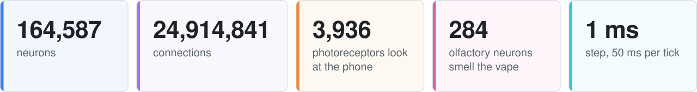
</picture>

<p align="center">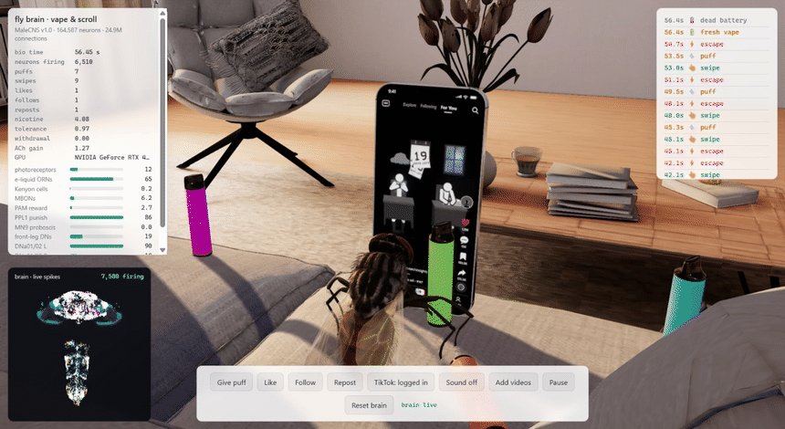</p>

**Figure 1.** *Nine seconds of the desktop app with the brain live. The fly lifts the vape for a hit, then swipes its phone on to the next video in its For You feed. Left: what the brain is doing, population by population. Bottom left: every neuron with a known cell body, lit as it spikes. Right: the log of what the fly just did. For the recording I pressed **Give puff** and triggered the swipe myself so they'd land inside the clip; everything else on screen is the brain.*

## Contents

| § | Section | Subsections |
|:-:|---|---|
| 1 | [What's in here](#1-whats-in-here) | |
| 2 | [Run it](#2-run-it) | [Desktop app](#21-desktop-app) · [3D models](#22-3d-models) |
| 3 | [What the fly does](#3-what-the-fly-does) | [The phone](#31-the-phone) · [The body](#32-the-body) · [Vapes](#33-vapes-and-running-out-of-them) · [Coughing fits and whiteys](#34-coughing-fits-and-whiteys) |
| 4 | [Live TikTok on the phone](#4-live-tiktok-on-the-phone) | [The account](#41-the-account) |
| 5 | [Headless TikTok runs](#5-headless-tiktok-runs) | [Where TikTok took the fly so far](#51-where-tiktok-took-the-fly-so-far) |
| 6 | [How it works](#6-how-it-works) | |
| 7 | [The maths](#7-the-maths) | [Wiring](#71-wiring-the-brain) · [Neuron](#72-the-neuron) · [Senses](#73-the-senses) · [Nicotine](#74-nicotine) · [Acting](#75-deciding-to-act) · [Coughs](#76-coughs-and-whiteys) · [Body](#77-the-body) · [Smoke](#78-smoke) · [Light](#79-light) · [Phone](#710-the-phone-and-the-brain-panel) · [Headless](#711-headless-runs) |
| 8 | [How fast it runs](#8-how-fast-it-runs) | |
| 9 | [The living room](#9-the-living-room) | |
| 10 | [Modelling choices (and where it's not biology)](#10-modelling-choices-and-where-its-not-biology) | |
| 11 | [Limitations](#11-limitations) | |
| 12 | [Project layout](#12-project-layout) | |
| 13 | [Data and credits](#13-data-and-credits) | |

## 1. What's in here

- **The whole wiring diagram.** 164,587 neurons and 24,914,841 connections from [MaleCNS v1.0](https://male-cns.janelia.org/). Who connects to whom, and whether the connection excites or inhibits, comes straight from the data and is never trained.
- **A spiking brain on the GPU.** Leaky integrate-and-fire neurons with the constants from Shiu et al. 2024 (Nature)[^shiu], plus short-term synaptic depression so it doesn't seize. Event-driven, so the cost scales with how many neurons fire, not with the 24.9M edges.
- **Senses wired to real neurons.** 3,936 photoreceptors look at the phone, 284 olfactory neurons from five fruity-ester glomeruli smell the vape, and nicotine acts on the cholinergic synapses and on the dopamine neurons.
- **Behaviour read off real neurons.** MN9 (proboscis) takes a puff, the descending neurons onto the front legs swipe, the giant fibre jumps, DNa01/DNa02 turn the head, and the PAM dopamine cluster decides what it likes.
- **A body that does it.** A housefly with a skeleton I built from its mesh, two-bone IK on every leg, a vape with a finite battery, smoke, coughing fits, whiteys, and a flight across the sofa for a fresh vape when the battery dies.
- **Its own TikTok account.** In the desktop app the phone plays the fly's real For You feed, and swipe, like, follow and repost go to tiktok.com. A headless runner does the same without the 3D and logs where the algorithm takes it.

<picture>
  <source media="(prefers-color-scheme: dark)" srcset="docs/img/fig/fig-somata-dark.png">
  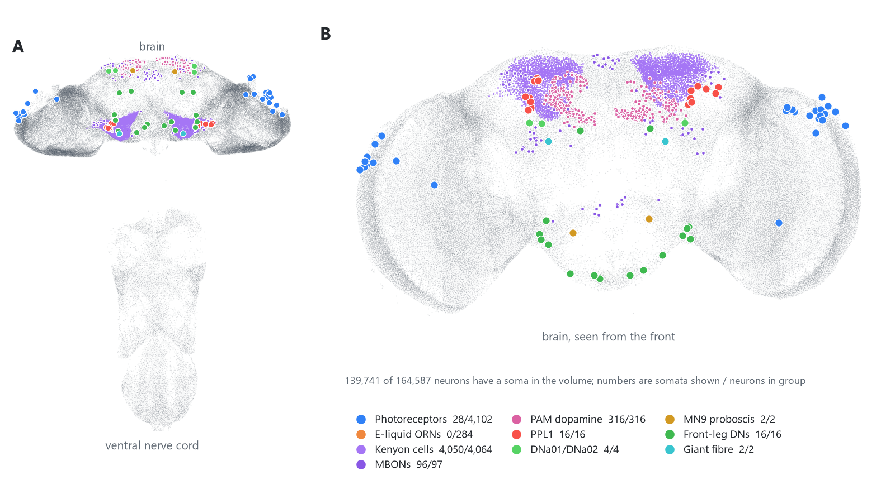
</picture>

**Figure 2.** *Every neuron with a cell body in the imaged volume, 139,741 of the 164,587, as grey points, with the groups the world reads and writes drawn on top. **A**: the whole CNS, the brain above the ventral nerve cord, the way the app's brain panel shows it. **B**: the brain alone, from the front. The legend gives somata shown out of neurons in the group: the photoreceptors (28 of 4,102) and the e-liquid ORNs (0 of 284) barely appear, because their cell bodies sit in the eye and the antenna, outside the volume. `python tools/make_figures.py` draws this and the figures below from `data/build/`.*

## 2. Run it

```bash
pip install -r brain/requirements.txt   # PyTorch with CUDA recommended
python brain/download_data.py           # ~570 MB into data/raw/
python brain/build_graph.py             # ~30 s, writes data/build/
python brain/server.py                  # brain on http://127.0.0.1:8765

cd web
npm install
npm run dev                             # open http://localhost:5173
```

> [!TIP]
> Use **Add videos** to put your own clips on the phone; without them a plain browser plays built-in procedural clips (one of them is a looming disc, aimed at the giant fibre). `python brain/bench.py` runs the brain headless and prints speed and firing rates.

### 2.1 Desktop app

```bash
cd web
npm run app    # builds the page, starts the brain server, opens its own window
```

The window asks Windows for the high-performance GPU, so on a laptop with two GPUs the scene renders on the discrete one; the HUD shows which GPU is drawing. The desktop app is the one with [live TikTok](#4-live-tiktok-on-the-phone).

### 2.2 3D models

The scene loads four GLB files from `models/`: `housefly.glb`, `iphone-13-pro-max.glb`, `elf-bar-1500-watermelon.glb` and `cozy-living-room.glb`. All four are from Sketchfab under CC BY 4.0; the authors are in [Data and credits](#13-data-and-credits), and anything you share made with them should credit them too.

The room is ["Cozy living room baked"](https://sketchfab.com/3d-models/cozy-living-room-baked-581238dc5fda4dc990571cdc02827783) by ChristyHsu (CC BY 4.0), shrunk from 100 MB to 11 MB with `npx @gltf-transform/cli optimize in.glb cozy-living-room.glb --compress meshopt --texture-compress webp --texture-size 1024 --simplify-error 0.0005`. The fly sits on one of its sofa cushions, with the room scaled up 3× around it.

The fly model has no skeleton, so `python tools/rig_housefly.py` builds one from its separate pieces (each leg segment, the head, the wings) and writes `models/housefly.rig.json`. Re-run it if you replace `housefly.glb`.

| Turn it around in GitHub's 3D viewer | |
|---|---|
| [`docs/3d/housefly.stl`](docs/3d/housefly.stl) | the housefly |
| [`docs/3d/elf-bar.stl`](docs/3d/elf-bar.stl) | the Elf Bar |

## 3. What the fly does

Everything below was screenshotted in the desktop app on 27 October 2026, with the phone on the fly's real For You feed.

<p align="center">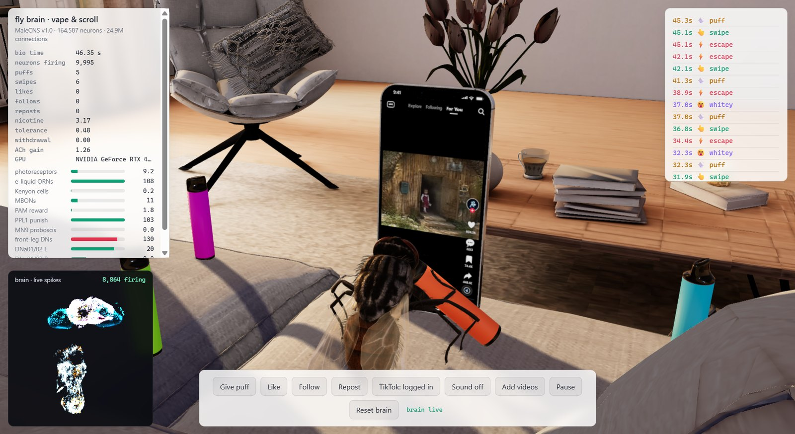</p>

**Figure 3.** *The desktop app 46 seconds into a session, all of it live. The fly is mid-hit (that one was the brain's decision, 45.3 s in the log). Five puffs in, nicotine is at 3.17 and tolerance at 0.48, so every cholinergic synapse is running at 1.26× strength, and the smell of e-liquid has its olfactory neurons at 108 Hz. The front-leg descending neurons are red because they're more than 2.5 standard deviations above their own baseline, which is the swipe signal; it swiped at 45.1 s and is still in its 2.5 s cooldown.*

### 3.1 The phone

<p align="center">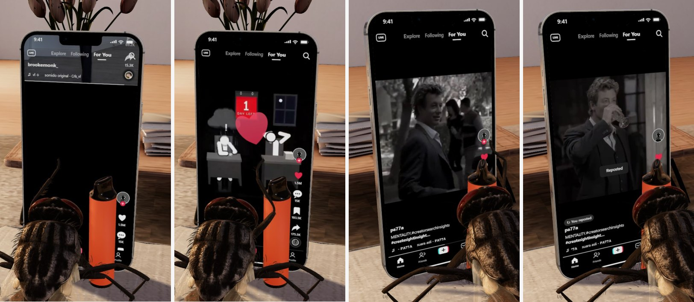</p>

**Figure 4.** *Left to right: a **swipe** (the old video slides up while the next one is still downloading, so it comes in black), a **like** (the double-tap heart, here on a cartoon by @pa77a), a **follow** (a tap on the creator's avatar in the right rail) and a **repost** (the "Reposted" toast, and a "You reposted" label above the caption, the way the TikTok app marks it). I triggered these four from the devtools with the brain paused, so the screenshot lands on the moment; in a normal session the brain decides them ([how](#75-deciding-to-act)).*

A swipe is the front leg sliding up the glass, which is also when the phone moves on and the hidden TikTok window is sent <kbd>↓</kbd>. A like is two quick taps with the other arm, a follow and a repost one tap each on the right rail. The fly alternates arms between swipes.

### 3.2 The body

<p align="center">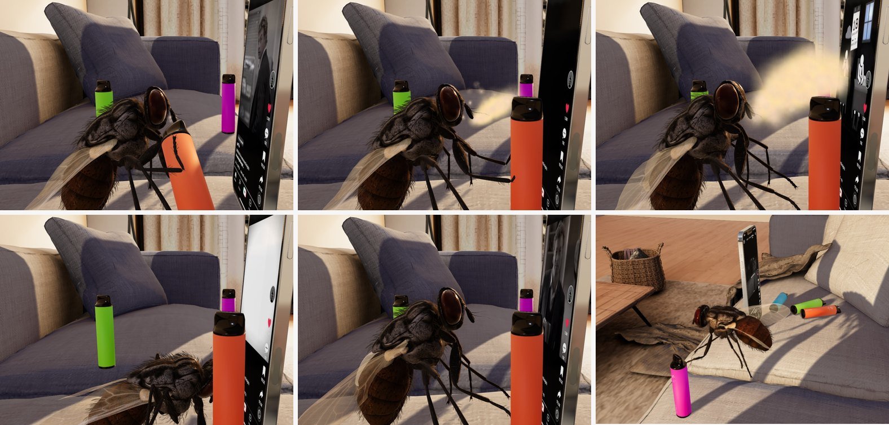</p>

**Figure 5.** *Top row: the **draw** (the vape at its mouth, the band lit), the **exhale**, and a **coughing fit** (it doubles over and the lungful comes straight back out). Bottom row: a **whitey** (legs folded, slumped against the phone), an **escape** (the giant fibre fired: wings flared, a hop), and the **trip out for a fresh vape** after a dead battery.*

<p align="center">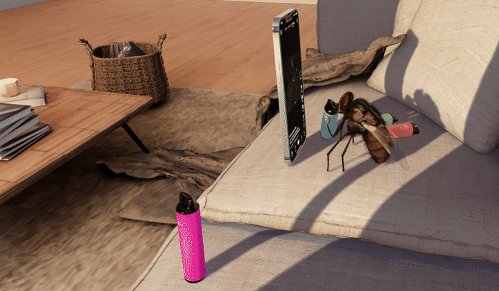</p>

**Figure 6.** *A flat battery. The band blinks the way a spent disposable does, the fly backhands the dead vape onto the cushion, flies to the nearest spare, grabs it with its front legs, carries it home slung under its body and lands with it. Real speed, 4.7 s for the trip.*

<p align="center">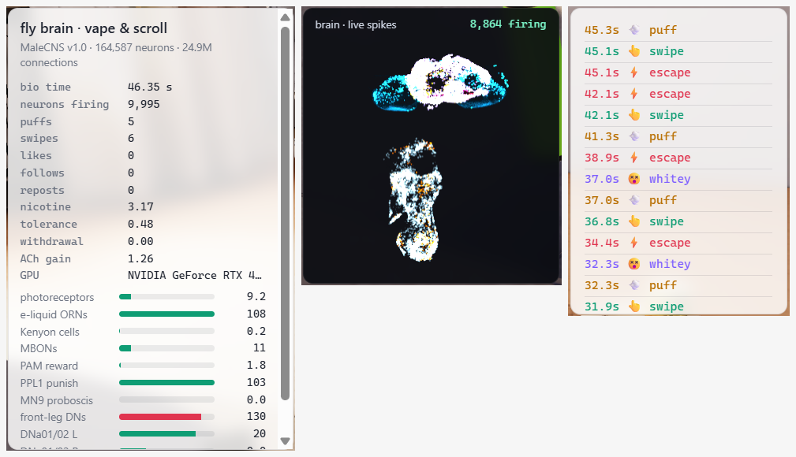</p>

**Figure 7.** *The three panels from the screenshot above. Left: bio time, counters, nicotine, and the firing rate of each population in Hz (a bar turns red at 2.5 standard deviations above its baseline). Middle: the brain, every soma as a point that flashes when its neuron spikes. Right: the log of what the fly did.*

### 3.3 Vapes, and running out of them

Each disposable holds a finite number of puffs: `VAPE_PUFFS` in `web/src/main.ts`, 6 by default. Draw on a flat one and nothing comes out: the band blinks four times, the way a spent disposable does, and there is no smoke. Three spares stand around the cushion (`SPARE_SPOTS`), each tinted a different flavour colour (`FLAVOURS`), so a fresh one doesn't read as the same vape respawning. A spare spot with no cushion under it is skipped, and the tint only lands on the printed wrap: the body is black plastic, and multiplying black by a colour leaves it black.

A flat battery sends the fly out for the nearest spare: the `fetch` action in `web/src/fly.ts`, 4.7 s end to end. It shakes with irritation, backhands the dead vape away (it tumbles, bounces and comes to rest lying on the cushion), takes off, flies over to the spare, grips it with its front legs, carries it home slung under its body and lands back on its seat with the new one standing where the old one stood. It flies rather than walks because it is a fly, and because a six-legged walk cycle would have been far more code for a worse result. Dead vapes are never tidied away; they lie where they stopped. With no spares left in the room the fly keeps drawing on a flat one. The HUD log marks each dead battery and each fetch.

### 3.4 Coughing fits and whiteys

A hit can also go wrong. Both ways are decided in `World.puff()` in `brain/world.py`, from the chemistry alone: no neuron votes on either ([the formulas](#76-coughs-and-whiteys)).

- **Coughing fit:** a harsh pull, one taken while the gut and the brain together already hold more than `cough_load_threshold` (3.5). Past that it is a risk rather than a rule: the chance climbs from 0 to the `cough_chance` ceiling (0.25) as the load reaches twice the threshold. The fly convulses for `cough_s` (3 s) and can't pull again or swipe until it stops. It loses most of that hit: `cough_dose_lost` (0.6) of the dose comes straight back out before the gut absorbs any of it.
- **Whitey:** the dose on its way in (`gut`, so an un-absorbed remainder of the last pull counts towards it) is more than `whitey_ratio` (1.6) times `tolerance + whitey_tolerance_floor` (0.5). Its legs fold under it and it slumps forward against the phone for `whitey_s` (3.5 s), and it can neither puff nor swipe until it comes round, because it is too gone to move. It banks no enjoyment while it lasts. With the defaults the first puffs on a clean fly always do this; they stop once tolerance passes 0.125, a few puffs in.

One pull gives at most one of the two, and the cough wins. Both are rolled inside `puff()`, so a puff forced from the **Give puff** button can cause them too, and the brain reports the seconds left as `cough_s_left` and `whitey_s_left`: exactly how long the fly holds the pose.

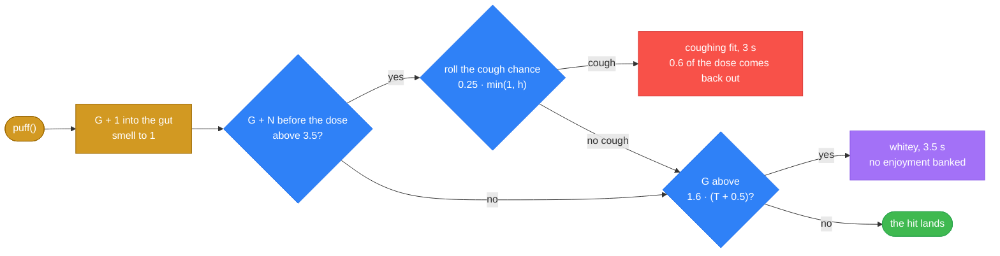

**Figure 8.** *`World.puff()` as a decision. The tests are the ones in [7.6](#76-coughs-and-whiteys).*

## 4. Live TikTok on the phone

The desktop app plays the fly's own TikTok account, **@aliteralhousefly**.

<p align="center">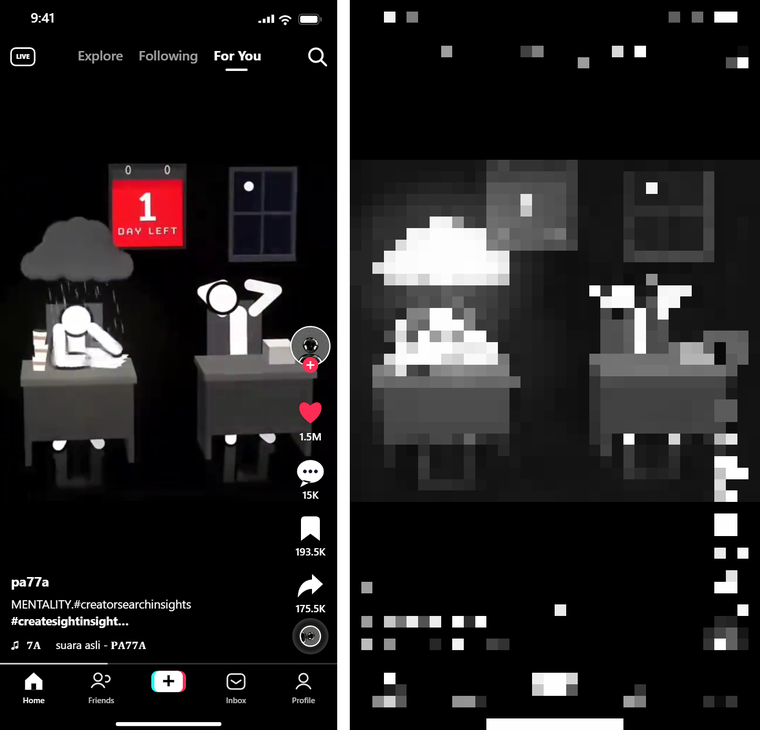</p>

**Figure 9.** *Left: the phone screen as the app draws it, 642×1389 px, a real video from the For You feed in TikTok's iPhone layout with its real author, caption, sound and counts. Right: what the fly's photoreceptors get from it, the same screen as 36×64 luma pixels, up to 20 times a second.*

- **Log in once:** run `npm run app` (from `web/`) and click **Log in to TikTok**. The session is stored in the app's own profile. A copy of its cookies is in `data/tiktok-session/cookies.json` for the headless runner; treat it like the password.
- **What the phone shows:** a hidden tiktok.com window scrolls the real For You feed, so the watching and swiping are TikTok's own. The phone does not stream that window. The app reads the feed's `/api/recommend/item_list/` replies off the hidden window's network traffic, downloads the next few videos whole (`FLY_TIKTOK_PRELOAD`, 4 by default) with each one's avatar, and the phone plays its own copy. It draws TikTok's iPhone layout around it, with the real author, caption, sound, counts and avatar, and slides to the next video on a swipe.
- **Why a copy:** streaming the hidden window re-encoded every frame, which capped the phone at about 10 fps and left a video black until it had buffered. Playing a downloaded file means the next video is decoded and waiting before the fly gets to it, so a swipe lands on it instantly. Photo posts play as their pictures, a few seconds each.
- **Staying in step:** the phone moves to the next video the moment the fly swipes, without waiting for TikTok. The hidden window is pressed <kbd>↓</kbd> up to three times until its own feed has moved too, so the fly's watch time lands on the video the phone is showing. The phone follows TikTok forward if TikTok ends up further down the feed, and never backward: TikTok lags while it scrolls, and it reports nothing at all for a photo post, neither of which means going back.
- **What the brain controls:**
  - swipe presses <kbd>↓</kbd>;
  - like presses <kbd>L</kbd>;
  - follow and repost click TikTok's own buttons in the page.
  - When these fire is set in `brain/world.py`: `like_threshold`, `follow_threshold`, `repost_threshold`, `follow_gap_s`, `repost_gap_s`.
- **Region:** For You follows the country TikTok sees. Run `FLY_TIKTOK_PROXY=socks5://host:port npm run app` to send only the fly's TikTok traffic through a proxy or VPN. The language is set to English.

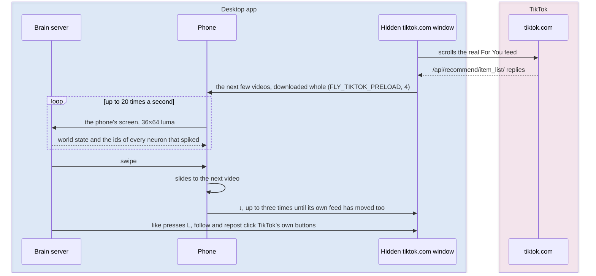

**Figure 10.** *The phone plays its own copy of the hidden window's feed, and the brain's actions go back to tiktok.com through that window.*

### 4.1 The account

<p align="center">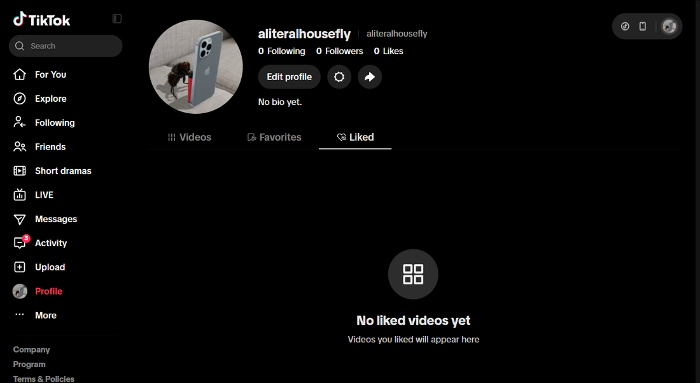</p>

**Figure 11.** *@aliteralhousefly right after the session these screenshots come from. In that session the fly liked several videos and followed and reposted one creator's video. The profile still says 0 following and "No liked videos yet", and has no Reposts tab.*

**Known limits:**

- TikTok doesn't keep what this automated window sends. A like turns the heart red, then back within about 4 s, and the count doesn't change; the headless runs saw the same. A follow leaves the follow button where it was. A repost gets the "Reposted" toast and the page reports success, but nothing shows up on the profile.
- Swipes and watch time are real, and those drive the For You feed most.
- The video CDN refuses a download without the session's cookies and a tiktok.com referer, so the downloads go through the hidden window's own session.

> [!CAUTION]
> Automating TikTok is against its terms, so the account can be restricted.

## 5. Headless TikTok runs

No 3D and nothing to watch: the brain scrolls a real TikTok For You feed in a headless Microsoft Edge and logs every video, so you can leave it running and see where the algorithm takes the fly. Needs `pip install playwright` (it drives the installed Edge; Playwright's own Chromium can't play TikTok's H.264).

```bash
python headless/run.py --login                 # visible Edge on data/tiktok-profile: log the fly in yourself, then close it
python headless/run.py                         # watch at natural speed until Ctrl+C
python headless/run.py --videos 100 --speed 5  # 5 s of video per brain second
python headless/run.py --dry                   # no browser: brain throughput on synthetic frames
python headless/report.py                      # markdown summary of the latest run (--all for every run)
```

Each 50 ms brain tick sees one 36×64 frame drawn from the playing `<video>`, and the video's playback rate is steered so video time stays at `--speed` × brain time ([the servo](#711-headless-runs)). `--speed` compresses what the fly watches, not TikTok traffic: swipes (ArrowDown) and likes (L) are at least `--min-swipe-gap` (2 s) and `--min-like-gap` (5 s) apart in real time. If the fly hasn't swiped after `--max-watch` brain seconds (30), it is swiped for it. `headless/fastbrain.py` runs the same `brain/lif.py` model as a CUDA graph ([about 6× faster](#8-how-fast-it-runs)), and `--eager` uses `Brain.run` itself.

<details>
<summary><b>Session cookies, proxies, windows, likes and the preroll</b></summary>

Exported session cookies in `data/tiktok-session/cookies.json` are imported when the profile has no session yet. Set `FLY_TIKTOK_PROXY` (`http://host:port` or `socks5://host:port`) to watch through a proxy. `--window offscreen` uses a normal Edge window placed off-screen, if headless Edge ever gets blocked. `--no-like`, `--max-likes N` and `--like-threshold X` are there for testing. Before the first video the brain runs `--preroll` seconds (2) on the first frame so its start-up burst doesn't seed World's running baselines; `--preroll 0` starts cold like `brain/server.py`. The fly's follow and repost actions are logged, not pressed.

A like counts as confirmed only when TikTok's like API accepts it. In testing, TikTok answered likes from this automated Edge (headless or in a window) with an empty reply and the heart went grey again after ~3 s, so likes may not stick; after two rejected likes a run stops pressing like and just logs what the fly wanted. Watching and swiping, which drive the For You feed most, work.

</details>

<details>
<summary><b>What a run log holds</b></summary>

Runs go to `data/tiktok-runs/<timestamp>.jsonl`: a header line with the settings (including `World.like_threshold`), then one line per video with its id, URL, author, caption, hashtags, sound, counts, sponsored flag, brain/video/real seconds watched, whether the fly liked it (and whether TikTok confirmed it), peak enjoyment, mean PAM rate, nicotine, puffs, and why it moved on (`fly_swipe`, `timeout`, `feed_moved`). The report lists top hashtags, authors and sounds, how they drift from the first to the last quarter and in rolling windows, watch time by hashtag, and what the fly liked.

</details>

### 5.1 Where TikTok took the fly so far

`python headless/report.py --all` over the four runs in `data/tiktok-runs/` (15 September 2026):

**Table 1.** *The four headless runs together.*

| | |
|---|---|
| videos | 27, at 1×, 2×, 3× and 5× speed |
| brain time | 2.4 min (5.4 s per video, median 4.1 s) |
| fly likes | 9 (33%), none confirmed by TikTok |
| would follow / repost (logged, not pressed) | 9 / 9 |
| top hashtags | #lyrics (22% of videos), #relatable (15%) |
| first 6 vs last 6 videos | like rate 0% → 83%, brain seconds watched 4.6 → 7.5 |
| overlap, first 6 vs last 6 | hashtags 3%, authors 0%, sounds 0% |

> [!WARNING]
> Twenty-seven videos is an anecdote, not a result: the report itself warns the drift is noisy at this size. These runs also predate the current like threshold (they used 2, it's 12 now), which is why the fly liked a third of what it saw.

## 6. How it works

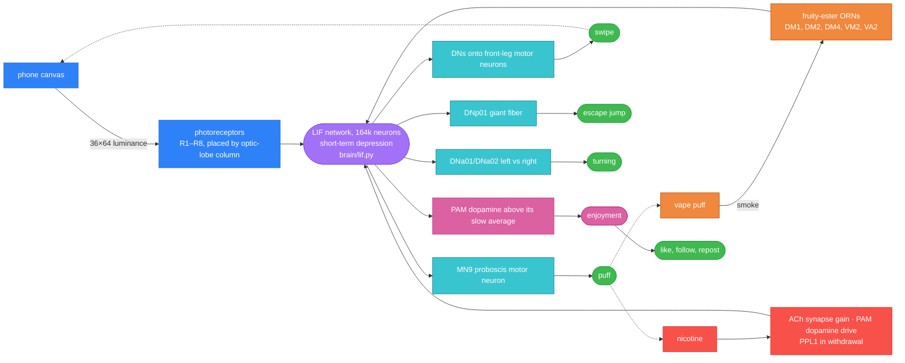

**Figure 12.** *From the senses to the behaviour. Dotted lines close the loop: a puff brings smoke and nicotine, a swipe changes what the phone shows.*

<details>
<summary><b>The same diagram as text</b></summary>

```
phone canvas ──36×64 luminance──▶ photoreceptors (R1–R8, placed by optic-lobe column)
vape puff ─────smoke──────────────▶ fruity-ester ORNs (DM1, DM2, DM4, VM2, VA2)
nicotine ──────────────────────────▶ ACh synapse gain · PAM dopamine drive · PPL1 in withdrawal
                                     │
                     LIF network, 164k neurons, short-term depression (brain/lif.py)
                                     │
MN9 proboscis motor neuron ──────────▶ puff
DNs onto front-leg motor neurons ────▶ swipe
DNp01 giant fiber ───────────────────▶ escape jump
DNa01/DNa02 left vs right ───────────▶ turning
PAM dopamine above its slow average ─▶ enjoyment ─▶ like, follow, repost
```

</details>

The browser sends the phone's screen up to 20 times a second. Each tick the server runs 50 steps of 1 ms (50 ms of brain time) on the latest frame, then sends back the world state and the ids of every neuron that spiked (at most 40,000, a random subset if more did).

<picture>
  <source media="(prefers-color-scheme: dark)" srcset="docs/img/fig/fig-raster-dark.png">
  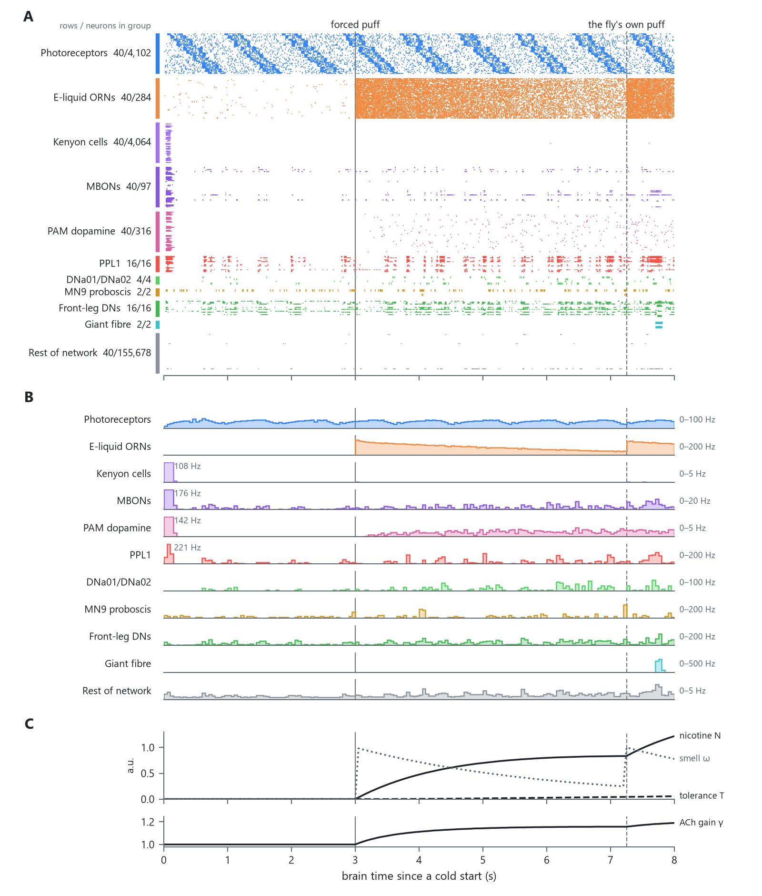
</picture>

**Figure 13.** *Eight seconds of the brain from a cold start: the same `Brain` and `World` the server runs, watching a bright bar move across the phone (the frames `brain/bench.py` uses). I forced one puff at 3.0 s (solid line); at 7.25 s MN9 burst to 130 Hz and the fly took one of its own (dashed), which was a whitey, and the giant fibre fired at 7.75 s. **A**: spikes, 40 rows each for the big groups and every neuron for the small ones; the photoreceptor rows are sorted by screen column, so each sweep of the bar is a diagonal. **B**: each group's rate per 50 ms tick. The start-up burst lasts about 150 ms and is clipped, with its peak written beside it. The smell takes the ORNs from about 1 Hz to 153 Hz and nicotine lifts PAM from 0 to about 1 Hz, while the Kenyon cells stay almost silent after the burst, so the smell never reaches the mushroom body. **C**: nicotine $`N`$, the smell $`\omega`$, tolerance $`T`$ and the cholinergic gain $`\gamma`$, which is 1.16 by the fly's own puff.*

**Table 2.** *The neuron groups the world reads and writes.*

| group | neurons | which ones |
|---|---:|---|
| photoreceptors | 4,102 | R1–R8 (3,936 placed on the eye) |
| e-liquid ORNs | 284 | olfactory neurons of DM1, DM2, DM4, VM2, VA2 |
| Kenyon cells | 4,064 | class `Kenyon_Cell` |
| MBONs | 97 | mushroom body output neurons |
| PAM reward | 316 | PAM01–PAM15 dopamine neurons |
| PPL1 punishment | 16 | PPL101–PPL108 |
| proboscis | 2 | MN9 |
| front leg | 16 | the 8 descending-neuron types with the most synapses onto front-leg (T1) motor neurons: DNge125, DNge002, DNg49, DNg93, DNge033, DNg105, DNge079, DNp31 |
| escape | 2 | DNp01, the giant fibre |
| steering | 2 + 2 | DNa01 and DNa02, left and right |
| forward / backward | 2 / 4 | DNp09 / MDN (moonwalker) |

## 7. The maths

Everything here is what the code computes, with the constants it uses. Time steps: $`\Delta t = 1`$ ms inside the network, $`\Delta t = 0.05`$ s for the world (one tick), and the frame time (capped at 0.05 s) for the animation.

**Table 3.** *The colours the formulas in 7.1 to 7.6 give each quantity.*

| symbol | what it is |
|:-:|---|
| $`{\color{#a371f7}W_{ij}},\ {\color{#a371f7}c_{ij}},\ {\color{#a371f7}\sigma_i}`$ | the wiring: weight, signed synapse count, transmitter sign |
| $`{\color{#2f81f7}v_j}`$ | membrane potential |
| $`{\color{#39c5cf}g_j}`$ | synaptic input |
| $`{\color{#3fb950}R_i}`$ | transmitter left |
| $`{\color{#f0883e}r_i},\ {\color{#f0883e}\omega}`$ | the senses: input rate, smell of e-liquid |
| $`{\color{#bf8700}G}`$ | the dose in the gut |
| $`{\color{#f85149}N},\ {\color{#f85149}\gamma}`$ | nicotine in the brain, and the gain it puts on cholinergic synapses |
| $`{\color{#8957e5}T}`$ | tolerance |
| $`{\color{#db61a2}E},\ {\color{#db61a2}\rho_{\text{PAM}}}`$ | enjoyment, and the PAM dopamine rate it comes from |

### 7.1 Wiring the brain

From [brain/build_graph.py](brain/build_graph.py). A connection's sign comes from the predicted transmitter of the neuron that sends it:

```math
{\color{#a371f7}\sigma_i} =
\begin{cases}
+1 & \text{acetylcholine, or } i \text{ is a photoreceptor}\\
-1 & \text{GABA, glutamate, histamine}\\
0 & \text{dopamine, serotonin, octopamine}\\
+\tfrac12 & \text{unclear}
\end{cases}
```

and its weight is its synapse count $`w_{ij}`$, signed and scaled to millivolts:

```math
{\color{#a371f7}c_{ij}} = \mathrm{rint}\bigl({\color{#a371f7}\sigma_i}\, w_{ij}\bigr),\qquad {\color{#a371f7}W_{ij}} = 0.275\ \text{mV}\cdot {\color{#a371f7}c_{ij}}
```

The weights are stored as a CSR matrix with one row per sending neuron, so delivering a spike reads only the row of the neuron that fired. The front-leg descending neurons are picked by how much they talk to the front-leg motor neurons:

```math
S(T) = \sum_{\substack{i \in \text{DN type } T\\ j \in \text{T1 motor neurons}}} w_{ij},\qquad \text{front leg} = \text{the 8 types with the largest } S(T)
```

<picture>
  <source media="(prefers-color-scheme: dark)" srcset="docs/img/fig/fig-degree-dark.png">
  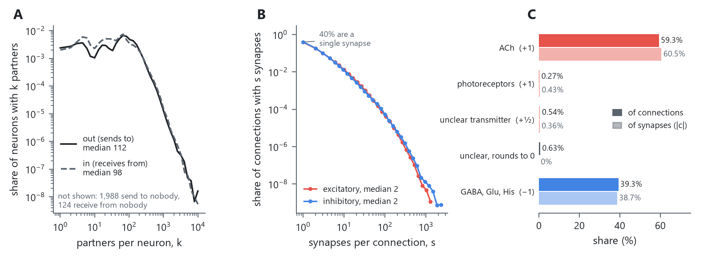
</picture>

**Figure 14.** *The connectome as it is stored in `data/build/graph.npz`, 24,914,841 connections. **A**: how many partners a neuron has. The median neuron sends to 112 and receives from 98, the busiest to and from over 11,000; 1,988 neurons send to nobody and 124 receive from nobody (not shown on log axes). **B**: synapses per connection, a heavy tail from 1 to 2,591. 40% of connections are a single synapse, and the median is 2 for excitatory and inhibitory alike. **C**: the signs from the formula above, as shares of connections and of synapses: 59% acetylcholine, 39% GABA, glutamate or histamine. Dopamine, serotonin and octopamine get no fast weight, so they are not stored at all, and 0.63% of connections are single synapses from an unclear sender, where $`\mathrm{rint}(0.5)`$ rounds to 0.*

<picture>
  <source media="(prefers-color-scheme: dark)" srcset="docs/img/fig/fig-groups-dark.png">
  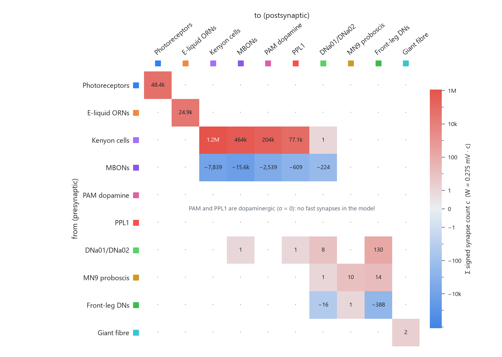
</picture>

**Figure 15.** *Direct connections between the groups of Table 2, as summed signed synapse counts $`\sum c_{ij}`$ on a log colour scale. The heavy traffic is inside the mushroom body: Kenyon cells onto each other (1.15M), onto MBONs (464k), PAM (204k) and PPL1 (77k), and MBONs back onto all of them with inhibition. PAM and PPL1 send nothing here, because dopamine has no fast weight; the sensory groups only connect among themselves, and the descending neurons mostly to each other.*

### 7.2 The neuron

From [brain/lif.py](brain/lif.py), after Shiu et al. 2024[^shiu]. Every 1 ms step, for every neuron $`j`$:

```math
\begin{aligned}
{\color{#39c5cf}g_j} &\leftarrow {\color{#39c5cf}g_j} + \sum_{i \,\in\, \mathcal{S}(t-2)} {\color{#f85149}\gamma_i}\, {\color{#3fb950}R_i}\, {\color{#a371f7}W_{ij}} \;+\; 40\ \text{mV}\cdot \mathbf{1}\{\xi_j < {\color{#f0883e}r_j}\,\Delta t\}\\
{\color{#2f81f7}v_j} &\leftarrow {\color{#2f81f7}v_j} + \frac{\Delta t}{\tau_m}\bigl(V_{\text{rest}} - {\color{#2f81f7}v_j} + {\color{#39c5cf}g_j}\bigr)\\
{\color{#39c5cf}g_j} &\leftarrow {\color{#39c5cf}g_j}\, e^{-\Delta t/\tau_{\text{syn}}}\\
{\color{#3fb950}R_j} &\leftarrow 1 - (1 - {\color{#3fb950}R_j})\, e^{-\Delta t/\tau_{\text{rec}}}
\end{aligned}
```

```math
{\color{#2f81f7}v_j} \ge V_\theta \;\Longrightarrow\; \text{spike:}\quad {\color{#2f81f7}v_j} \leftarrow V_{\text{reset}} \text{ and held there for 2 steps},\qquad {\color{#3fb950}R_j} \leftarrow (1 - u)\, {\color{#3fb950}R_j}
```

- $`{\color{#2f81f7}v_j}`$ is the membrane potential and $`{\color{#39c5cf}g_j}`$ the synaptic input, both in mV. $`\mathcal{S}(t-2)`$ is the set of neurons that spiked two steps ago (the 1.8 ms synaptic delay, rounded).
- $`{\color{#3fb950}R_i} \in [0, 1]`$ is how much transmitter neuron $`i`$ has left. Each spike uses a fraction $`u`$ of it and it recovers with $`\tau_{\text{rec}}`$. This short-term depression is mine, on top of the published model: without it, driving thousands of sensory neurons at once throws the network into a self-sustaining seizure.
- $`{\color{#f85149}\gamma_i}`$ is the nicotine gain for cholinergic senders ([section 7.4](#74-nicotine)) and 1 for everything else.
- The last term is the senses: neuron $`j`$ gets an external Poisson spike with probability $`{\color{#f0883e}r_j}\,\Delta t`$, where $`{\color{#f0883e}r_j}`$ is its input rate in Hz and $`\xi_j`$ is uniform on $`[0, 1)`$.

**Table 4.** *The neuron's constants.*

| constant | value | | constant | value |
|---|---|---|---|---|
| $`V_{\text{rest}} = V_{\text{reset}}`$ | −52 mV | | $`\tau_m`$ | 20 ms |
| $`V_\theta`$ | −45 mV | | $`\tau_{\text{syn}}`$ | 5 ms |
| refractory | 2.2 ms (2 steps) | | synaptic delay | 1.8 ms (2 steps) |
| weight per synapse | 0.275 mV | | input kick | 40 mV |
| $`u`$ | 0.1 | | $`\tau_{\text{rec}}`$ | 300 ms |
| $`\Delta t`$ | 1 ms (the paper uses 0.1) | | steps per tick | 50 |

### 7.3 The senses

From [brain/world.py](brain/world.py) and [web/src/phone.ts](web/src/phone.ts). The phone's screen is shrunk to 36×64 pixels and turned into luma with the BT.709 weights:

```math
L_{rc} = \frac{1}{255}\Bigl\lfloor 0.2126\, R'_{rc} + 0.7152\, G'_{rc} + 0.0722\, B'_{rc} \Bigr\rfloor
```

Each photoreceptor sits at a point $`(u_i, v_i) \in [0, 1]^2`$ of its eye, from the optic-lobe column of the cell it talks to most. The two eyes face the phone side by side with an overlap in the middle:

```math
x_i =
\begin{cases}
0.6\, u_i & \text{left eye}\\
0.4 + 0.6\, u_i & \text{right eye}
\end{cases},\qquad
(c_i, r_i) = \bigl(\lfloor 35\, x_i \rfloor,\ \lfloor 63\, v_i \rfloor\bigr)
```

and fires at a rate that grows with brightness and, much more, with change since the last frame $`L'`$:

```math
{\color{#f0883e}r_i} = \min\Bigl(5 + 50\, L_{r_i c_i} + 250\, \bigl\lvert L_{r_i c_i} - L'_{r_i c_i} \bigr\rvert,\ 300\Bigr)\ \text{Hz}
```

The 284 e-liquid olfactory neurons fire at $`4 + 160\,{\color{#f0883e}\omega}`$ Hz, where $`{\color{#f0883e}\omega} \in [0, 1]`$ is the smell of e-liquid around the antennae.

### 7.4 Nicotine

From [brain/world.py](brain/world.py). A puff puts a dose of 1 into the gut $`{\color{#bf8700}G}`$ and sets the smell $`{\color{#f0883e}\omega}`$ to 1. From there it is absorbed into the brain as nicotine $`{\color{#f85149}N}`$, which is cleared, and tolerance $`{\color{#8957e5}T}`$ slowly follows it:

```math
\frac{d{\color{#bf8700}G}}{dt} = -\frac{{\color{#bf8700}G}}{1.5\ \text{s}},\qquad
\frac{d{\color{#f85149}N}}{dt} = \frac{{\color{#bf8700}G}}{1.5\ \text{s}} - \frac{{\color{#f85149}N}}{25\ \text{s}},\qquad
\frac{d{\color{#8957e5}T}}{dt} = \frac{{\color{#f85149}N} - {\color{#8957e5}T}}{60\ \text{s}},\qquad
\frac{d{\color{#f0883e}\omega}}{dt} = -\frac{{\color{#f0883e}\omega}}{3\ \text{s}}
```

The code steps these exactly with exponentials every 50 ms tick. Tolerance blunts the effect, and nicotine below tolerance is withdrawal:

```math
n = \max\bigl(0,\ {\color{#f85149}N} - \tfrac12 {\color{#8957e5}T}\bigr),\qquad \text{withdrawal} = \max(0,\ {\color{#8957e5}T} - {\color{#f85149}N})
```

Nicotine reaches the brain three ways: it strengthens every cholinergic synapse (nicotinic receptors), gives the PAM reward neurons a mild lift, and in withdrawal drives the PPL1 punishment neurons:

```math
{\color{#f85149}\gamma} = 1 + 0.35\, \frac{n}{n + 1},\qquad
{\color{#db61a2}r_{\text{PAM}}} = 6\, \frac{n}{n + 1}\ \text{Hz},\qquad
r_{\text{PPL1}} = 120 \cdot \text{withdrawal}\ \text{Hz}
```

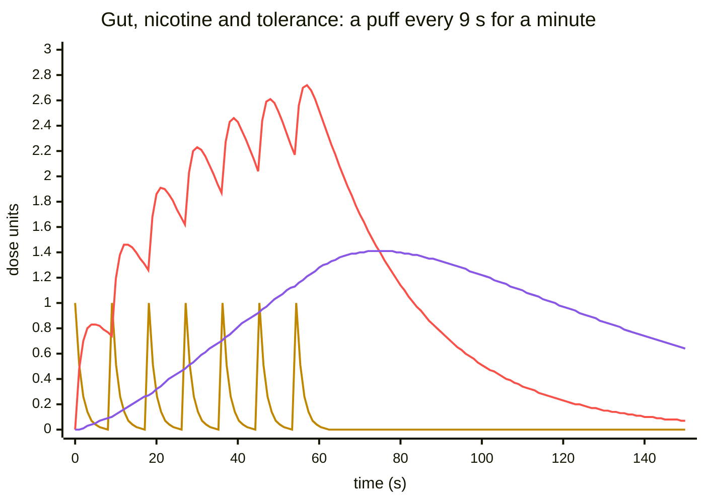

**Figure 16.** *The equations above for seven puffs 9 s apart, then none: $`{\color{#bf8700}G}`$ (gold) jumps by 1 at each puff and drains in seconds, $`{\color{#f85149}N}`$ (red) climbs to 2.72, and $`{\color{#8957e5}T}`$ (violet) trails it, peaks at 1.41 and is still above $`{\color{#f85149}N}`$ two minutes later. With puffs this far apart $`{\color{#bf8700}G} + {\color{#f85149}N}`$ never reaches 3.5, so no pull is harsh; the first two are whiteys, because $`{\color{#8957e5}T}`$ is still under 0.125 ([7.6](#76-coughs-and-whiteys)). Computed from the formulas, not recorded from a session; the controls on the chart zoom and pan.*

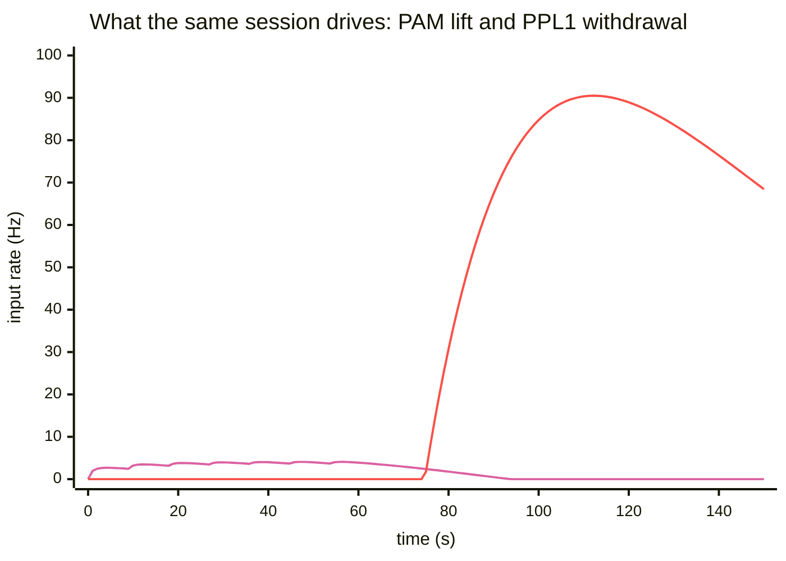

**Figure 17.** *The same two and a half minutes as the input rates they set. While the fly is puffing, $`{\color{#db61a2}r_{\text{PAM}}}`$ (pink) never gets past 4.1 Hz. Once it stops, $`{\color{#f85149}N}`$ falls under $`{\color{#8957e5}T}`$ at 75 s and withdrawal drives PPL1 (red) up to 90 Hz: on these constants, stopping is a far louder signal than smoking.*

### 7.5 Deciding to act

From [brain/world.py](brain/world.py). Each tick, every readout group's firing rate is compared with its own running baseline. With $`c_i`$ the spikes of neuron $`i`$ in the tick:

```math
\rho_k = \frac{1}{\lvert k \rvert\, \Delta t} \sum_{i \in k} c_i,\qquad
z_k = \frac{\rho_k - \mu_k}{\sqrt{s_k^2 + 1}}
```

and the baseline moves as an exponential average with $`\tau = 8`$ s ($`\alpha = 1 - e^{-\Delta t/\tau}`$, $`\delta = \rho_k - \mu_k`$):

```math
\mu_k \leftarrow \mu_k + \alpha\, \delta,\qquad s_k^2 \leftarrow (1 - \alpha)\bigl(s_k^2 + \alpha\, \delta^2\bigr)
```

The $`+1`$ under the square root keeps a nearly silent group from turning one stray spike into a huge z-score. Enjoyment builds while the PAM dopamine cluster fires above its own slow average ($`\tau = 30`$ s), in Hz·s, and goes back to zero on every swipe:

```math
{\color{#db61a2}E} \leftarrow {\color{#db61a2}E} + \max\bigl(0,\ {\color{#db61a2}\rho_{\text{PAM}}} - \bar\mu_{\text{PAM}}\bigr)\, \Delta t
```

After the first 4 s (the brain's start-up burst):

**Table 5.** *What each action needs, and how long it blocks.*

| action | fires when | then blocked for |
|---|---|---|
| puff | $`z_{\text{MN9}} > 2.5`$ | 4 s |
| swipe | $`z_{\text{front leg}} > 2.5`$ | 2.5 s |
| escape | the giant fibre spikes at all | 3 s |
| like | $`{\color{#db61a2}E} > 12`$, once per video | swipe held 1.5 s |
| follow | $`{\color{#db61a2}E} > 14`$ and liked | 120 s |
| repost | $`{\color{#db61a2}E} > 16`$ and liked | 300 s |

The head turns with $`z_{\text{right}} - z_{\text{left}}`$ of DNa01/DNa02, and nicotine makes the body jittery with $`\min(1, {\color{#f85149}N})`$.

### 7.6 Coughs and whiteys

From `World.puff()`. With $`{\color{#bf8700}G}`$ and $`{\color{#f85149}N}`$ as they were before the dose lands:

```math
h = \frac{{\color{#bf8700}G} + {\color{#f85149}N}}{3.5} - 1,\qquad
P(\text{cough}) =
\begin{cases}
0.25\, \min(1,\ h) & h > 0\\
0 & \text{otherwise}
\end{cases}
```

A cough takes back most of the hit, $`{\color{#bf8700}G} \leftarrow \max(0,\ {\color{#bf8700}G} - 0.6)`$, and lasts 3 s. Without a cough, with $`{\color{#bf8700}G}`$ now including the new dose:

```math
{\color{#bf8700}G} > 1.6\,\bigl({\color{#8957e5}T} + 0.5\bigr) \;\Longrightarrow\; \text{whitey, 3.5 s}
```

On a clean fly the first pull leaves $`{\color{#bf8700}G} = 1`$, so it whiteys exactly while $`{\color{#8957e5}T} < 0.125`$.

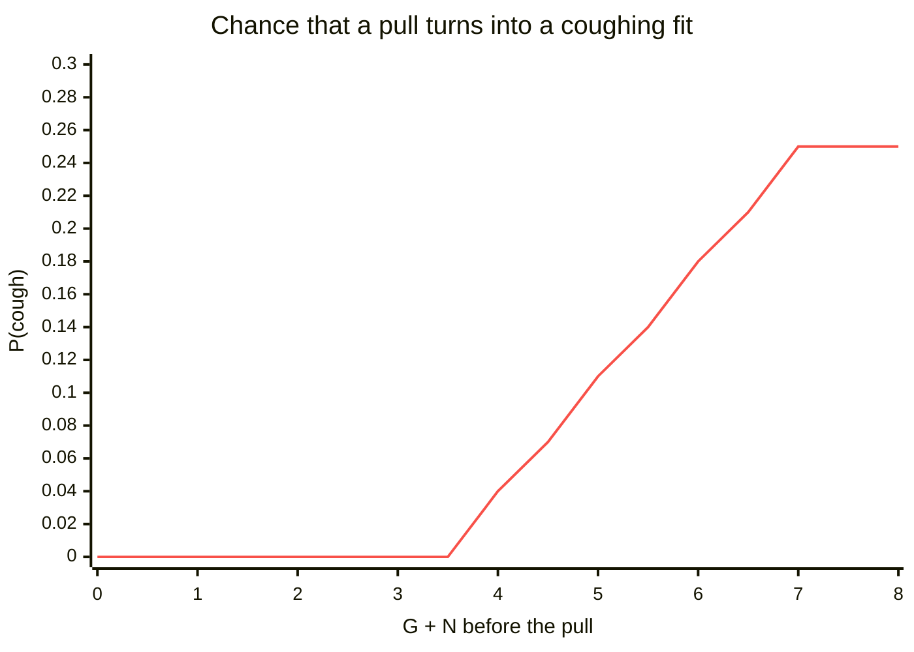

**Figure 18.** *$`P(\text{cough})`$ against the load already on board: nothing up to 3.5, then a straight climb to the 0.25 ceiling at twice that.*

### 7.7 The body

From [web/src/fly.ts](web/src/fly.ts). The choreography is built from three curves of the time $`\tau`$ since an action started:

```math
S(x) = \bar x^2 (3 - 2\bar x),\ \ \bar x = \min(1, \max(0, x)),\qquad
\mathrm{ramp}(\tau; a, b) = S\Bigl(\frac{\tau - a}{b - a}\Bigr),\qquad
\mathrm{bump}(\tau; a, b) = \sin\Bigl(\pi\, \frac{\tau - a}{b - a}\Bigr)\ \text{on } (a, b)
```

<details>
<summary><b>Legs</b>: two-bone IK by the law of cosines</summary>

**Legs.** Every leg is solved with two-bone IK by the law of cosines. With the hip $`\mathbf{h}`$, the target $`\mathbf{j}`$ for the ankle, femur and tibia lengths $`l_1, l_2`$ and a pole vector $`\mathbf{p}`$ that says which way the knee bends:

```math
\begin{aligned}
d &= \mathrm{clamp}\bigl(\lVert \mathbf{j} - \mathbf{h} \rVert,\ \lvert l_1 - l_2 \rvert,\ l_1 + l_2\bigr),\qquad \hat{\mathbf{u}} = \frac{\mathbf{j} - \mathbf{h}}{\lVert \mathbf{j} - \mathbf{h} \rVert}\\
\cos\alpha &= \frac{l_1^2 + d^2 - l_2^2}{2\, l_1\, d},\qquad
\hat{\mathbf{b}} = \frac{\mathbf{p} - (\mathbf{p} \cdot \hat{\mathbf{u}})\, \hat{\mathbf{u}}}{\lVert \mathbf{p} - (\mathbf{p} \cdot \hat{\mathbf{u}})\, \hat{\mathbf{u}} \rVert}\\
\text{knee} &= \mathbf{h} + l_1 \cos\alpha\, \hat{\mathbf{u}} + l_1 \sin\alpha\, \hat{\mathbf{b}},\qquad
\text{ankle} = \mathbf{h} + d\, \hat{\mathbf{u}}
\end{aligned}
```

and each bone is turned onto its segment with the shortest-arc rotation. To put the tip of a leg on the glass, the ankle target is set one tarsus length back from the contact point, along the screen's normal tilted slightly from below.

</details>

<details>
<summary><b>A hit</b> (3.4 s): two envelopes that chase their targets</summary>

**A hit** (3.4 s). The arms reach and the vape rises on two envelopes, and both chase their targets so an interrupted hit glides back instead of snapping:

```math
\text{grab}^\star = \mathrm{ramp}(\tau; 0, 0.5)\bigl(1 - \mathrm{ramp}(\tau; 2.8, 3.3)\bigr),\qquad
\text{up}^\star = \mathrm{ramp}(\tau; 0.5, 1.1)\bigl(1 - \mathrm{ramp}(\tau; 2.2, 2.8)\bigr)
```

```math
y \leftarrow y + \min(1,\ 9\, \Delta t)\, (y^\star - y)
```

The draw is at $`\tau = 1.1`$ s (the band lights, or blinks if the battery is dead) and the exhale at 2.45 s.

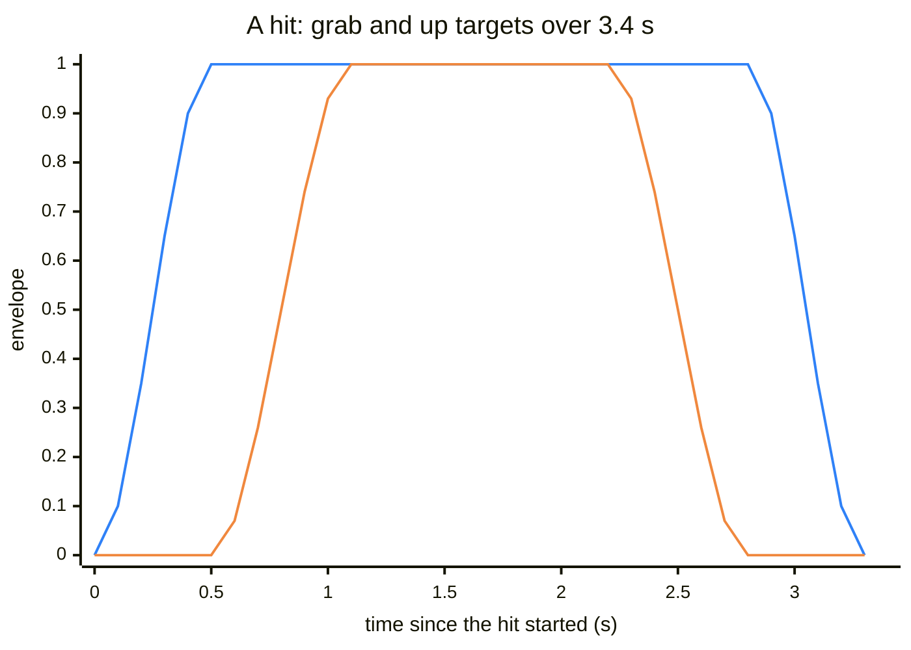

**Figure 19.** *$`\text{grab}^\star`$ (blue) and $`\text{up}^\star`$ (orange): the arms are on the vape before it rises, and it is down again before they let go.*

</details>

<details>
<summary><b>A swipe</b> (1.2 s) and the taps</summary>

**A swipe** (1.2 s). The leg slides up the screen, in screen coordinates $`(u, v) \in [-1, 1]^2`$, on the side $`s = \pm 1`$ of the arm doing it:

```math
\mathbf{P}_{\text{swipe}} = \mathrm{lerp}\Bigl(\mathbf{S}(0.35 s,\ -0.4),\ \mathbf{S}(0.35 s,\ 0),\ \mathrm{ramp}(\tau; 0.35, 0.7)\Bigr)
```

and a tap hovers 0.05 off the glass and dips onto it, twice for a like:

```math
\text{dip}_{\text{like}} = \mathrm{bump}(\tau; 0.3, 0.5) + \mathrm{bump}(\tau; 0.55, 0.75),\qquad
\text{dip}_{\text{follow, repost}} = \mathrm{bump}(\tau; 0.3, 0.7)
```

</details>

<details>
<summary><b>Coughs, whiteys and escapes</b></summary>

**Coughs, whiteys and escapes.** A cough is one half-sine over the fit, $`C = \mathrm{bump}(\tau; 0, T_c)`$, that drives fast jerks of the body (34 rad/s), the head (47 rad/s) and the wings. A whitey folds the legs in 0.5 s and lets go over the last 0.9 s:

```math
W = \mathrm{ramp}(\tau; 0, 0.5)\Bigl(1 - \mathrm{ramp}\bigl(\tau;\ \max(0.55,\ T_w - 0.9),\ T_w\bigr)\Bigr)
```

An escape is a 0.9 s startle: a hop of $`0.05\, \mathrm{bump}(\tau; 0, 0.5)`$ and a wing buzz of $`\mathrm{bump}(\tau; 0, 0.9)`$.

</details>

<details>
<summary><b>The fetch</b> (4.7 s) and <b>the thrown vape</b></summary>

**The fetch** (4.7 s). Airborne $`A`$, trip $`\Pi`$ and carry $`K`$ envelopes overlap; the fly flies a straight line from its seat $`\mathbf{x}_0`$ to a point $`\mathbf{H}`$ 0.24 above the spare, bobbing with its wingbeat:

```math
\begin{aligned}
A &= \mathrm{ramp}(\tau; 0.8, 1.3)\bigl(1 - \mathrm{ramp}(\tau; 4.1, 4.6)\bigr),\qquad
\Pi = \mathrm{ramp}(\tau; 1.0, 2.45)\bigl(1 - \mathrm{ramp}(\tau; 2.85, 4.2)\bigr)\\
\mathbf{x} &= \mathrm{lerp}(\mathbf{x}_0,\ \mathbf{H},\ \Pi) + \bigl(0,\ A\,(0.05 + 0.012 \sin 26 t),\ 0\bigr)
\end{aligned}
```

**The thrown vape** ([web/src/vape.ts](web/src/vape.ts)). The dead vape is flicked back and to the fly's right at $`v_0 \sim \mathcal{U}(2.8, 3.6)`$ with a random spin $`\boldsymbol\omega`$, then falls under gravity scaled to the room:

```math
\mathbf{v}(0) = v_0\, \hat{\boldsymbol\ell} + \bigl(0,\ \tfrac12 v_0,\ 0\bigr),\qquad
v_y \leftarrow v_y - g\, \Delta t,\qquad \mathbf{x} \leftarrow \mathbf{x} + \mathbf{v}\, \Delta t,\qquad g = 9.8 \times 3 = 29.4
```

On each landing it bounces, losing two thirds of its speed and most of its spin, and after three bounces, or once it is slow enough, it lies flat along the throw:

```math
v_y \leftarrow \lvert v_y \rvert,\qquad \mathbf{v} \leftarrow 0.34\, \mathbf{v},\qquad \boldsymbol\omega \leftarrow 0.4\, \boldsymbol\omega,\qquad
\text{rest when } n_{\text{bounce}} \ge 3 \ \text{ or } \ \lVert \mathbf{v} \rVert^2 \le 0.05
```

</details>

### 7.8 Smoke

From [web/src/smoke.ts](web/src/smoke.ts). An exhale is a stream of 160 sprites a second for 1.6 s. Every frame, each sprite slows down, rises and gets pushed around by a moving swirl, with a random phase $`\varphi`$ per sprite:

```math
\begin{aligned}
v_x &\leftarrow e^{-1.6\, \Delta t}\, v_x + 0.12\, \Delta t\, \sin(7 y + 1.3 t + \varphi)\\
v_y &\leftarrow e^{-1.6\, \Delta t}\, v_y + 0.09\, \Delta t\\
v_z &\leftarrow e^{-1.6\, \Delta t}\, v_z + 0.12\, \Delta t\, \cos(6 x - 1.1 t + \varphi)
\end{aligned}
```

Over its life $`\lambda \in [0, 1]`$ (2.8 to 5 s) a sprite grows to 5× its size and fades in fast and out slowly:

```math
\text{size} \propto 1 + 4\sqrt{\lambda},\qquad
\alpha = 0.75\, \alpha_{\text{tex}}\, \mathrm{smoothstep}(0, 0.06, \lambda)\bigl(1 - \mathrm{smoothstep}(0.3, 1, \lambda)\bigr)
```

The puffs themselves are five octaves of value noise under a round falloff, and smoke seen against the sun is tinted amber, more at its thin edges.

### 7.9 Light

From [web/src/room.ts](web/src/room.ts). The sun stands low through the window:

```math
\hat{\mathbf{s}} = \frac{(11.5,\ 3.2,\ 6.2)}{13.45} = (0.855,\ 0.238,\ 0.461),\qquad
\text{elevation} = \arctan\frac{3.2}{\sqrt{11.5^2 + 6.2^2}} = 13.8^\circ
```

The room's lighting is baked, so a real-time light can't touch it ([why](#9-the-living-room)). The golden hour is painted onto the baked colour in the shader instead, warm where a surface faces the sun and cool elsewhere:

```math
\mathbf{c}_{\text{out}} = \mathbf{c}_{\text{baked}} \odot \Bigl(\mathbf{T}_{\text{shade}} + \mathbf{T}_{\text{sun}}\, \max\bigl(\hat{\mathbf{n}} \cdot \hat{\mathbf{s}},\ 0\bigr)^{1/2}\Bigr),\qquad
\mathbf{T}_{\text{shade}} = ({\color{#f85149}0.66},\ {\color{#3fb950}0.63},\ {\color{#2f81f7}0.71}),\quad \mathbf{T}_{\text{sun}} = ({\color{#f85149}1.5},\ {\color{#3fb950}0.82},\ {\color{#2f81f7}0.14})
```

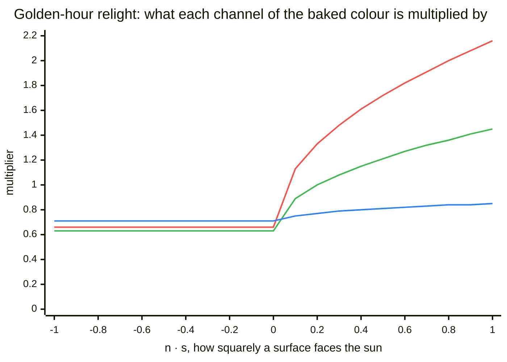

**Figure 20.** *Red, green and blue multipliers from the formula above. Facing away from the sun everything gets the cool, slightly blue shade; facing it, red rises to 2.16× and blue barely moves, which is the amber.*

The fly's wings glow amber where the membrane faces the sun, from either side:

```math
\mathbf{c}_{\text{out}} \leftarrow \mathbf{c}_{\text{out}} + (1.25,\ 0.68,\ 0.28)\; \mu\; \bigl\lvert \hat{\mathbf{n}}_w \cdot \hat{\mathbf{s}} \bigr\rvert^{0.6}
```

where $`\mu`$ is 1 on the membrane and dark along the veins.

### 7.10 The phone and the brain panel

From [web/src/phone.ts](web/src/phone.ts) and [web/src/brainView.ts](web/src/brainView.ts). A swipe slides the old video up and the next one in over 0.32 s with an ease-in-out:

```math
k \leftarrow \min\Bigl(1,\ k + \frac{\Delta t}{0.32}\Bigr),\qquad
E(k) =
\begin{cases}
2k^2 & k < \tfrac12\\
1 - \tfrac12 (2 - 2k)^2 & k \ge \tfrac12
\end{cases}
```

A video within 20% of the screen's aspect ratio $`a_0 = 428/843`$ fills it; anything wider is letterboxed:

```math
\frac{\lvert a - a_0 \rvert}{a_0} < 0.2 \;\Longrightarrow\; \text{cover, scale } \max\Bigl(\frac{428}{w},\ \frac{843}{h}\Bigr),\qquad \text{otherwise letterbox}
```

In the brain panel a spike sets its neuron's point to full heat, which then fades with a 0.25 s time constant, and the point grows with it:

```math
h_i \leftarrow 1 \text{ on a spike},\qquad h_i \leftarrow h_i\, e^{-\Delta t/0.25},\qquad \text{point size} = \frac{5\,(0.6 + 2.4\, h_i)}{\text{depth}}
```

### 7.11 Headless runs

From [headless/run.py](headless/run.py). The brain watches $`s`$ seconds of video per brain second (`--speed`). With $`b`$ the brain seconds and $`v`$ the video seconds seen on this video, $`a = v - s\,b`$ is how far the video is ahead, and the playback rate is

```math
r =
\begin{cases}
0 \ (\text{pause}) & a > 0.25 \max(1, s)\\
\mathrm{clip}\Bigl(\dfrac{0.05\, s}{\bar\tau} - a,\ \tfrac{1}{16},\ 16\Bigr) & \text{otherwise}
\end{cases}
,\qquad \bar\tau \leftarrow \bar\tau + 0.1\,\bigl(\Delta t_{\text{wall}} - \bar\tau\bigr)
```

The first term plays exactly one tick's worth of video in one tick's wall time $`\bar\tau`$; the second closes any gap in about a second. [headless/report.py](headless/report.py) measures drift as the overlap of what the fly saw early and late, and which hashtags it liked more than it saw:

```math
J = \frac{\lvert A_{\text{first}} \cap A_{\text{last}} \rvert}{\lvert A_{\text{first}} \cup A_{\text{last}} \rvert},\qquad
\mathrm{lift}(t) = \frac{c_{\text{liked}}(t) / N_{\text{liked}}}{c_{\text{all}}(t) / N}
```

## 8. How fast it runs

Measured on a laptop RTX 4060 (8 GB):

**Table 6.** *Brain speed.*

| | brain seconds per wall second | how |
|---|---|---|
| `brain/lif.py`, what the app's server runs | **0.28 – 0.34** | `python brain/bench.py`: 2 s of brain time in 5.9 – 7.1 s, timing only `Brain.run` |
| `headless/fastbrain.py`, the same model as a CUDA graph | **1.95** | `python headless/run.py --dry`: 20 s of brain time in 10.3 s, 25.7 ms per 50 ms tick, whole loop timed, 0.31 GB of GPU memory at peak |

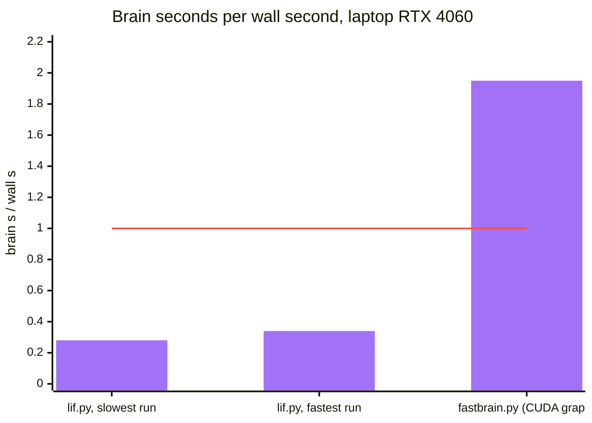

**Figure 21.** *The bars are Table 6; the red line is real time.*

So the CUDA graph is about 6× faster. The network fires 0.22 – 0.31 million spikes per brain second in the benchmark, with 3,000 – 6,000 neurons active in a given 50 ms tick. The server doesn't pace itself to the clock: the app's brain runs as fast as the GPU lets it, which on this laptop is about a third of real time, so the fly sees roughly three seconds of video for every second it thinks.

## 9. The living room

The fly sits on the sofa in `models/cozy-living-room.glb`. The room's lighting is baked with Blender's Cycles renderer: smooth surfaces get lightmaps, and dense clutter (plants, the basket, the merged furniture) gets its light baked into vertex colours. The result lives in `models/room-baked/`. To bake it again, for example after changing the lights in `tools/bake_room.py`:

```bash
cd web
node scripts/decode-glb.mjs ../models/cozy-living-room.glb ../data/room/cozy-living-room.decoded.glb
cd ..
blender -b --factory-startup --python tools/bake_room.py -- data/room/cozy-living-room.decoded.glb models/room-baked
cd web
node scripts/compress-glb.mjs ../models/room-baked/room.glb ../models/room-baked/room.glb
```

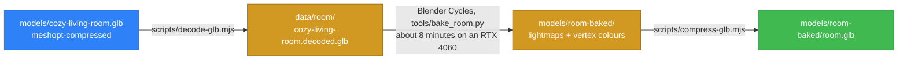

**Figure 22.** *The bake, step by step.*

Blender can't read the room's meshopt compression, hence the decode step; the bake takes about 8 minutes on an RTX 4060. Without `models/room-baked/` the app falls back to the unbaked room.

> [!IMPORTANT]
> The scene is lit as a late afternoon: a low amber sun, a cool sky fill and a painted dusk gradient behind the window. The room itself cannot take part in that, and this is the thing to know before changing any of it. Baking turned every baked object into an unlit `MeshBasicMaterial` carrying a lightmap or vertex colours, so a real-time light reaches only the fly, the vape, the phone and the smoke: add a light and the room will not change by a pixel. Its golden hour is therefore a shader-level relight injected with `onBeforeCompile` (`relight()` in `web/src/room.ts`, [the formula](#79-light)): whatever faces the window picks up amber and everything else falls back to a cooler skylight. Two related workarounds: a baked material can't receive a real-time shadow either, so an invisible `ShadowMaterial` copy of the sofa catches them (`addShadowCatcher`), and the painted view through the window was never baked, so it is tinted with the sunset directly.

The sun's direction is not a guess. `tools/bake_room.py` puts the window's area light at room (−0.80, 1.70, −3.80); `main.ts` turns and scales the room around the sofa spot, which leaves that window at world (9.4, 3.5, 4.5). `SUN_POSITION` in `room.ts` points there, about 14° above the horizon, and the real-time key light in `main.ts` copies it, so the fly's shadow and the room's shading agree. Changing the look means changing both ends: the lights in `main.ts` for the fly and its props, `SUN_TINT`, `SHADE_TINT` and `EXPOSURE` in `room.ts` for the room.

The fly is about 28 cm long next to the furniture; `ROOM_SCALE` in `web/src/main.ts` sets that (units per metre: 3 by default, 120 for a real 7 mm fly, at which point the sofa's textures and polygons are too coarse to look good).

## 10. Modelling choices (and where it's not biology)

- **Neurons:** leaky integrate-and-fire with constants from Shiu et al. 2024 (Nature)[^shiu], at a 1 ms step instead of 0.1 ms, for speed (rates stay within ~15% of a 0.5 ms step).
- **Synapse sign** from predicted transmitters: acetylcholine excites; GABA, glutamate and histamine inhibit. Dopamine, serotonin and octopamine get no fast weight, since they act through slow receptors. Photoreceptor output is treated as excitatory, because a spiking model can't pass signal through inhibition of silent lamina cells.
- **Short-term synaptic depression** is added on top of the published model. Without it, driving thousands of sensory neurons at once throws the network into a self-sustaining seizure.
- **Actions** fire when a population's rate rises 2.5 standard deviations above its own running baseline. Which neurons count as "proboscis" or "front leg" comes from annotations and direct connectivity; the thresholds are mine.
- **Nicotine, smell and the fly's movements** are simplified, hand-tuned models. The wiring is real; the chemistry and the choreography are not.
- **Coughing fits and whiteys** are hand-tuned models of what a hit does to a body, not connectome wiring: `World.puff()` rolls them from gut, nicotine and tolerance with the thresholds above, and no neuron is consulted. What they block afterwards (puffing, and swiping during a whitey) is a cooldown, not a paralysed network.

## 11. Limitations

- The fly's brain is real; its body, its chemistry and its taste are not. Nicotine is three exponentials, enjoyment is a running sum of dopamine firing, and every threshold that turns firing into a puff or a like is a number I picked.
- The eye was never built to look at a phone. Photoreceptors are placed by the optic-lobe column of their strongest partner, which is a coarse retinotopy, not the real eye's geometry. The data also has more of the right eye than the left: 2,273 photoreceptors placed against 1,663. The phone's 428×926 screen goes into 36×64 pixels without keeping its shape (squashed 1.22× vertically), status bar and tab bar included.
- The brain isn't locked to real time ([how fast it runs](#8-how-fast-it-runs)). In the app the fly lives at about a third of real time; headless runs keep video and brain time in step on purpose.
- TikTok doesn't keep the fly's likes, follows or reposts from these automated windows. What reaches the algorithm is what it watches and when it swipes.
- The like threshold was calibrated on a few headless runs before the side effects existed, and a whitey now banks no enjoyment while it lasts, so it wants re-measuring.
- The app starts the brain cold on the first frame, while headless runs give it 2 s of preroll first, so their baselines start from different places.

## 12. Project layout

<details open>
<summary><b>Every file and what it does</b></summary>

```
fly-hit-vape-and-scroll-tiktok/
  brain/
    download_data.py         the three MaleCNS tables, ~570 MB
    build_graph.py           raw tables -> signed CSR connectome, neuron groups, retina map, soma positions
    lif.py                   event-driven leaky integrate-and-fire network in PyTorch
    world.py                 sensory encoding, nicotine and tolerance, coughs and whiteys, behaviour readouts
    server.py                FastAPI + WebSocket loop streaming state and spikes
    bench.py                 the brain headless: speed and firing rates
  headless/
    run.py                   the brain scrolls a real For You feed in headless Edge and logs every video
    fastbrain.py             lif.py as a CUDA graph, for the headless runs
    feed.py                  drives Edge: frames from the <video>, swipes, likes
    report.py                markdown summary of a run: hashtags, authors, sounds, drift
  web/
    src/main.ts              the scene: room, golden-hour lights, phone, fly, vapes, and the frame sent to the brain
    src/fly.ts               the housefly on its skeleton: hits, swipes and taps with leg IK, fetches, coughs, whiteys
    src/phone.ts             TikTok-style feed canvas that doubles as the fly's visual input
    src/vape.ts              the Elf Bar: glowing band, puff count, the tumble of a thrown one
    src/smoke.ts             textured, swirling vape smoke
    src/room.ts              baked lightmaps and vertex-colour lighting, the golden-hour relight on top
    src/brainView.ts         every soma as a point that lights up when its neuron spikes
    src/brainPanel.ts        the brain window pinned to the bottom-left corner
    src/hud.ts               readout bars, counters and the log of what the fly just did
    src/models.ts            loads the GLB models and the fly's rig from models/
    src/net.ts               the WebSocket link to the brain server
    electron/main.cjs        desktop window: starts the brain server, renders on the discrete GPU
    electron/tiktok.cjs      the hidden For You window, and the videos it downloads ahead for the phone
    electron/feed-preload.cjs  runs inside that window: which video is playing, its author, caption, counts, like/follow state
    scripts/decode-glb.mjs   unpack the room for Blender
    scripts/compress-glb.mjs compress the baked room for the web
  tools/
    rig_housefly.py          builds models/housefly.rig.json by turning the fly's mesh pieces into bones
    bake_room.py             Blender script that bakes the room's lighting
    make_figures.py          the data figures in this README
  models/                    the four GLB models, the fly's rig and the baked room
  docs/img/                  the pictures in this README
  docs/3d/                   the fly and the vape as STL, for GitHub's 3D viewer
```

</details>

## 13. Data and credits

- **Connectome:** FlyEM male CNS connectome v1.0, HHMI Janelia Research Campus and Google Research, CC BY 4.0, [male-cns.janelia.org](https://male-cns.janelia.org/).
- **Neuron model:** Shiu et al. 2024, *A Drosophila computational brain model reveals sensorimotor processing*, Nature.
- **3D models:** from Sketchfab, all [CC BY 4.0](https://creativecommons.org/licenses/by/4.0/). I compressed the room, baked its lighting into `models/room-baked/` and built a skeleton for the fly (`models/housefly.rig.json`).
  - ["Cozy living room baked"](https://sketchfab.com/3d-models/cozy-living-room-baked-581238dc5fda4dc990571cdc02827783) by [ChristyHsu](https://sketchfab.com/ida61xq)
  - ["Housefly"](https://sketchfab.com/3d-models/housefly-5fe7cbd25f9a446d8bae005893d010dd) by [schmoldt.art](https://sketchfab.com/schmoldt.art)
  - ["Apple iPhone 13 Pro Max"](https://sketchfab.com/3d-models/apple-iphone-13-pro-max-4328dea00e47497dbeac73c556121bc9) by [DatSketch](https://sketchfab.com/DatSketch)
  - ["Elf Bar 1500 watermelon"](https://sketchfab.com/3d-models/elf-bar-1500-watermelon-480ab02f839a44d4a0bc45cbb7a9a678) by [fed0rochka1987](https://sketchfab.com/fed0rochka1987)
- **TikTok:** the videos in the screenshots are other people's posts as they came up on the fly's For You feed, shown here as they appeared in the app.

<details>
<summary><b>Cite this</b></summary>

```bibtex
@misc{fly-hit-vape-and-scroll-tiktok,
  author       = {S1MS4},
  title        = {fly hit vape and scroll tiktok},
  year         = {2026},
  howpublished = {\url{https://github.com/S1MS4/fly-hit-vape-and-scroll-tiktok}}
}
```

</details>

[^malecns]: FlyEM male CNS connectome v1.0, HHMI Janelia Research Campus and Google Research, CC BY 4.0. [male-cns.janelia.org](https://male-cns.janelia.org/)
[^shiu]: Shiu et al. 2024, *A Drosophila computational brain model reveals sensorimotor processing*, Nature.
